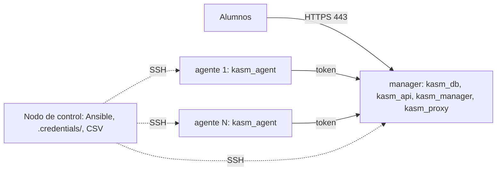

# Kasm manager + agentes (modo clúster)

[English](cluster.md) · [Volver al README](../README.es.md)

`pepesan.kasm.site_kasm_cluster` instala Kasm Workspaces en varias máquinas con el **layout oficial**: un **manager**
(base de datos + aplicación web, sin agente local) y N **agentes** que se registran en él. Es un modo distinto del
todo-en-uno de [`site_kasm`](usage.es.md) (Kasm dentro de un contenedor `linuxserver/kasm`) y no se mezclan en el mismo host.

## Topología



Cada nodo necesita un registro DNS A público que apunte a su `ansible_host` (el preflight lo comprueba).

## Inventario

Grupos: `kasm_manager` (un único host), `kasm_agents` y `kasm_cluster`, cuyos hijos son los otros dos. Direcciones y
nombres solo de documentación:

```ini
[kasm_manager]
manager ansible_host=192.0.2.10 node_name=manager

[kasm_agents]
agent-01 ansible_host=192.0.2.11 node_name=agent-01
agent-02 ansible_host=192.0.2.12 node_name=agent-02

[kasm_cluster:children]
kasm_manager
kasm_agents

[kasm_cluster:vars]
ansible_user=root
ansible_python_interpreter=/usr/bin/python3
kasm_base_domain=kasm.example.com
kasm_manager_hostname=manager.kasm.example.com
kasm_training_project=curso-2026
letsencrypt_email=ops@example.com
```

El FQDN de un agente es `<node_name>.<kasm_base_domain>` (o el nombre del inventario si ya contiene un punto).

## Variables principales

| Variable | Por defecto | Para qué |
|---|---|---|
| `kasm_manager_hostname` | — (**obligatoria**) | FQDN del manager; también la URL que se escribe en el CSV. |
| `kasm_base_domain` | `example.com` | Sufijo de los nombres de los agentes. |
| `kasm_training_project` | `""` | Nombre del proyecto: forma parte del nombre de los CSV y de los ficheros de contraseña. |
| `kasm_version` | `1.19.0` | Versión de Kasm de manager y agentes (manténgala igual). |
| `kasm_cluster_agents_serial` | `100%` | Agentes instalados por tanda (todos a la vez por defecto). El manager siempre va primero. |
| `kasm_cluster_workspaces` | `[]` | Lista de `{name, image}`. Vacía: el workspace por defecto de `kasm_workspace`. El resto de variables `kasm_workspace_*` valen para todos. |
| `kasm_cluster_groups` | `[]` | Lista de nombres de grupo. Vacía: `All Users`. Las variables `kasm_group_*` valen para todos. |
| `kasm_cluster_users` | `[]` | Lista de `{username, group, workspaces: [nombres], password}`; `password` es opcional (si no, se genera). `group` y `workspaces` solo se reflejan en el CSV. |
| `kasm_credentials_dir` | ver abajo | Directorio `.credentials/` del nodo de control. |
| `kasm_credentials_csv_dir` | el directorio actual | Directorio de los CSV en el nodo de control. |

Fije `kasm_credentials_dir` **una sola vez** (por ejemplo en `group_vars/all.yml`): los roles de manager, agente, usuario
y CSV tienen cada uno su valor por defecto y deben coincidir en dónde están el token y las contraseñas.

```yaml
kasm_cluster_workspaces:
  - {name: "Core Ubuntu", image: "pepesan/core-ubuntu-resolute:1.20"}
kasm_cluster_groups: [alumnos]
kasm_cluster_users:
  - {username: alice, group: alumnos, workspaces: ["Core Ubuntu"]}
  - {username: bob, group: alumnos, workspaces: ["Core Ubuntu"]}
```

## Qué hace `site_kasm_cluster`, en orden

1. **Preflight** de manager y agentes (`preflight_kasm_cluster`, que también se puede lanzar solo). Hace fallar toda la
   ejecución antes de que ningún rol cambie nada: registro DNS A público contra `ansible_host` (el `dns_preflight.yml` del
   rol `kasm`), sistema operativo soportado (Ubuntu 24.04/26.04, Debian 12/13), puertos 80 y 443 libres en los nodos aún
   no instalados, y SSH y Python (recogida de facts).
2. Manager: `docker` + `kasm_manager`. Genera el token de registro de los agentes.
3. Agentes: `docker` + `kasm_agent`, por tandas de `kasm_cluster_agents_serial`.
4. Imágenes de los workspaces descargadas en cada agente con `kasm_docker_image` en modo host (`kasm_docker_image_exec: docker`).
5. En el manager: `kasm_workspace`, `kasm_group` y `kasm_user` (acceso a la base de datos con `docker exec kasm_db`).
6. Los dos ficheros CSV.

```bash
ansible-playbook -i inventory.ini pepesan.kasm.preflight_kasm_cluster   # solo las comprobaciones
ansible-playbook -i inventory.ini pepesan.kasm.site_kasm_cluster
```

Una segunda ejecución no cambia nada: los nodos ya instalados se saltan por su marcador `.pepesan_install_complete_<rol>`.

## Ficheros CSV

Ambos están en `kasm_credentials_csv_dir`, con modo 600 y el nombre de `kasm_training_project`:

| Fichero | Para | Filas | Columnas |
|---|---|---|---|
| `cluster-access-<proyecto>.csv` | el operador; **no se reparte nunca** | una por nodo | `role,node,fqdn,ip,ssh_user,ssh_password,kasm_url,kasm_admin_user,kasm_admin_password,kasm_manager_token,kasm_version` |
| `user-access-<proyecto>.csv` | los alumnos; se puede repartir | una por usuario de Kasm | `kasm_url,kasm_user,kasm_user_password,kasm_group,workspaces` (nombres separados por `;`) |

`kasm_admin_user`, `kasm_admin_password` y `kasm_manager_token` solo se rellenan en la fila del manager; `ssh_password` va
vacío si se conecta con clave. Las contraseñas de la base de datos y de Redis y la API key **no** están en ningún CSV: se
quedan en `.credentials/` (recuperación ante desastre, no operación diaria). Las filas se ordenan por `node` / `kasm_user`
y se actualizan por esa clave, así que repetir la ejecución nunca las duplica.

El CSV se genera siempre a partir de `<kasm_credentials_dir>/cluster-meta.json` (sin secretos) y de los ficheros de
contraseña de `<kasm_credentials_dir>`, así que se puede regenerar sin tocar los nodos y con los mismos bytes:

```bash
python3 <colección>/roles/kasm_credentials/files/update_cluster_csv.py --kind cluster \
  --csv-dir ./csv --credentials-dir ./.credentials --project curso-2026 --from-credentials
python3 <colección>/roles/kasm_credentials/files/update_user_csv.py \
  --csv-dir ./csv --credentials-dir ./.credentials --project curso-2026 --from-credentials
```

Los secretos solo viajan en variables de entorno (`KASM_CSV_<COLUMNA>`), nunca en la línea de comandos.

## Desinstalar

[`kasm_uninstall`](../roles/kasm_uninstall/README.es.md) acepta `kasm_uninstall_layout: agent` o `manager`. Desinstale
primero los agentes y el manager al final; Docker y `/etc/letsencrypt` se conservan. El playbook `kasm_uninstall` del
paquete apunta al grupo `kasm`, así que use su propio play:

```yaml
- hosts: kasm_agents
  vars: {kasm_uninstall_layout: agent}
  roles: [pepesan.kasm.kasm_uninstall]

- hosts: kasm_manager
  vars: {kasm_uninstall_layout: manager}
  roles: [pepesan.kasm.kasm_uninstall]
```
