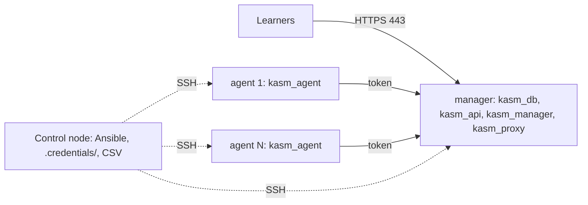

# Kasm manager + agents (cluster mode)

[Español](cluster.es.md) · [Back to the README](../README.md)

`pepesan.kasm.site_kasm_cluster` installs Kasm Workspaces on several machines with the **official layout**: one
**manager** (database + web app, no local agent) and N **agents** that register with it. It is a different mode from the
all-in-one install of [`site_kasm`](usage.md) (Kasm inside one `linuxserver/kasm` container) and the two do not mix on
the same host.

## Topology



Every node needs a public DNS A record that points at its `ansible_host` (the preflight checks it).

## Inventory

Groups: `kasm_manager` (exactly one host), `kasm_agents` and `kasm_cluster`, whose children are the other two.
Documentation-only addresses and names:

```ini
[kasm_manager]
manager ansible_host=192.0.2.10 node_name=manager

[kasm_agents]
agent-01 ansible_host=192.0.2.11 node_name=agent-01
agent-02 ansible_host=192.0.2.12 node_name=agent-02

[kasm_cluster:children]
kasm_manager
kasm_agents

[kasm_cluster:vars]
ansible_user=root
ansible_python_interpreter=/usr/bin/python3
kasm_base_domain=kasm.example.com
kasm_manager_hostname=manager.kasm.example.com
kasm_training_project=course-2026
letsencrypt_email=ops@example.com
```

The agent FQDN is `<node_name>.<kasm_base_domain>` (or the inventory name if it already contains a dot).

## Key variables

| Variable | Default | Purpose |
|---|---|---|
| `kasm_manager_hostname` | — (**required**) | FQDN of the manager; also the URL written to the CSV. |
| `kasm_base_domain` | `example.com` | Suffix of the agent names. |
| `kasm_training_project` | `""` | Project name: part of the CSV names and of the password file names. |
| `kasm_version` | `1.19.0` | Kasm release for manager and agents (keep it equal). |
| `kasm_cluster_agents_serial` | `100%` | Agents installed per batch (all at once by default). The manager is always done first. |
| `kasm_cluster_workspaces` | `[]` | List of `{name, image}`. Empty: the default workspace of `kasm_workspace`. Other `kasm_workspace_*` variables apply to all. |
| `kasm_cluster_groups` | `[]` | List of group names. Empty: `All Users`. `kasm_group_*` variables apply to all. |
| `kasm_cluster_users` | `[]` | List of `{username, group, workspaces: [names], password}`; `password` is optional (otherwise generated). `group` grants membership in an existing group; `workspaces` are reported in the CSV. Every workspace in `kasm_cluster_workspaces` is granted to each group in `kasm_cluster_groups`. |
| `kasm_credentials_dir` | see below | Control-node directory with `.credentials/`. |
| `kasm_credentials_csv_dir` | the current directory | Control-node directory of the CSV files. |

Set `kasm_credentials_dir` **once** (for example in `group_vars/all.yml`): the manager, agent, user and CSV roles each
have their own default and must agree on where the token and the passwords are.

```yaml
kasm_cluster_workspaces:
  - {name: "Core Ubuntu", image: "pepesan/core-ubuntu-resolute:1.20"}
kasm_cluster_groups: [students]
kasm_cluster_users:
  - {username: alice, group: students, workspaces: ["Core Ubuntu"]}
  - {username: bob, group: students, workspaces: ["Core Ubuntu"]}
```

## What `site_kasm_cluster` does, in order

1. **Preflight** of manager and agents (`preflight_kasm_cluster`, which can be run alone). It fails the whole run before
   any role changes anything: public DNS A record against `ansible_host` (the `kasm` role's `dns_preflight.yml`),
   supported operating system (Ubuntu 24.04/26.04, Debian 12/13), ports 80 and 443 free on nodes that are not installed
   yet, and SSH and Python (fact gathering).
2. Manager: `docker` + `kasm_manager`. It generates the agent registration token.
3. Agents: `docker` + `kasm_agent`, in batches of `kasm_cluster_agents_serial`.
4. On the manager, set registered agents' `prune_images_mode` to `No Prune` (otherwise Kasm's default `Aggressive` policy deletes pre-pulled custom images). Images then remain cached until explicitly removed; monitor disk use.
5. Pull workspace images on the agents with `kasm_docker_image` in host mode (`kasm_docker_image_exec: docker`).
6. On the manager: `kasm_workspace`, `kasm_group` and `kasm_user` (database access through `docker exec kasm_db`).
7. Write the two access CSVs.

```bash
ansible-playbook -i inventory.ini pepesan.kasm.preflight_kasm_cluster   # only the checks
ansible-playbook -i inventory.ini pepesan.kasm.site_kasm_cluster
```

A second run changes nothing: installed nodes are skipped through their `.pepesan_install_complete_<role>` marker.

## CSV files

Both live in `kasm_credentials_csv_dir`, mode 600, named after `kasm_training_project`:

| File | For | Rows | Columns |
|---|---|---|---|
| `cluster-access-<project>.csv` | the operator; **never hand it out** | one per node | `role,node,fqdn,ip,ssh_user,ssh_password,kasm_url,kasm_admin_user,kasm_admin_password,kasm_manager_token,kasm_version` |
| `user-access-<project>.csv` | learners; may be handed out | one per Kasm user | `kasm_url,kasm_user,kasm_user_password,kasm_group,workspaces` (names separated by `;`) |

`kasm_admin_user`, `kasm_admin_password` and `kasm_manager_token` are only filled on the manager row; `ssh_password` is
empty when you connect with a key. Database and Redis passwords and the API key are **not** in any CSV: they stay in
`.credentials/` (disaster recovery, not daily operation). Rows are sorted by `node` / `kasm_user` and upserted, so a
rerun never duplicates them.

The CSV is always rendered from `<kasm_credentials_dir>/cluster-meta.json` (no secrets) plus the password files in
`<kasm_credentials_dir>`, so it can be regenerated without touching the nodes, with the same bytes:

```bash
python3 <collection>/roles/kasm_credentials/files/update_cluster_csv.py --kind cluster \
  --csv-dir ./csv --credentials-dir ./.credentials --project course-2026 --from-credentials
python3 <collection>/roles/kasm_credentials/files/update_user_csv.py \
  --csv-dir ./csv --credentials-dir ./.credentials --project course-2026 --from-credentials
```

Secrets only travel in environment variables (`KASM_CSV_<COLUMN>`), never on the command line.

## Uninstall

[`kasm_uninstall`](../roles/kasm_uninstall/README.md) takes `kasm_uninstall_layout: agent` or `manager`. Uninstall the
agents first and the manager last; Docker and `/etc/letsencrypt` are kept. The packaged `kasm_uninstall` playbook targets
the `kasm` group, so use your own play:

```yaml
- hosts: kasm_agents
  vars: {kasm_uninstall_layout: agent}
  roles: [pepesan.kasm.kasm_uninstall]

- hosts: kasm_manager
  vars: {kasm_uninstall_layout: manager}
  roles: [pepesan.kasm.kasm_uninstall]
```
